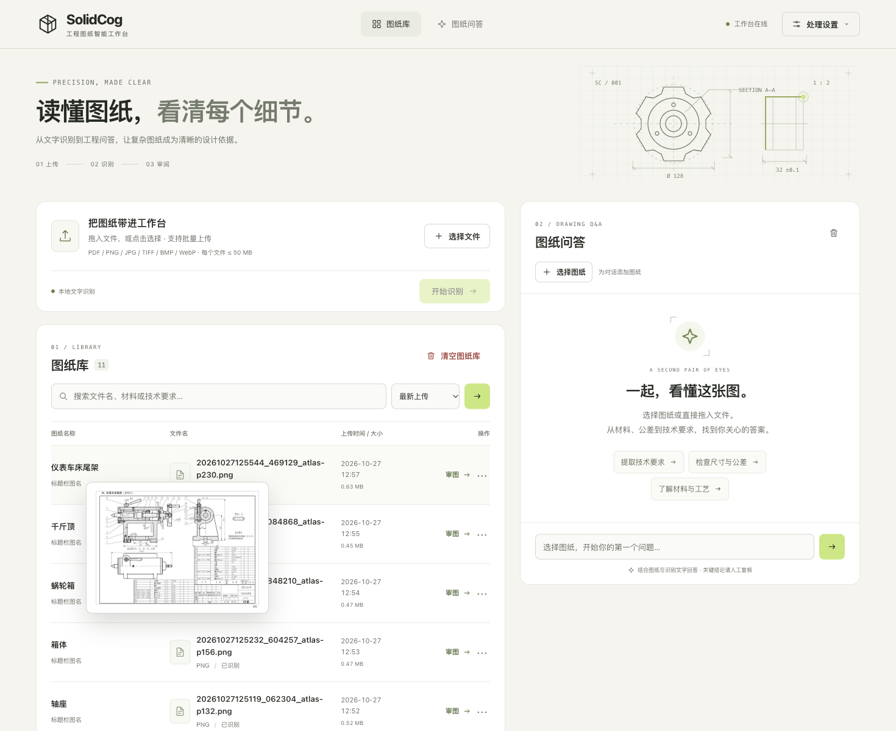
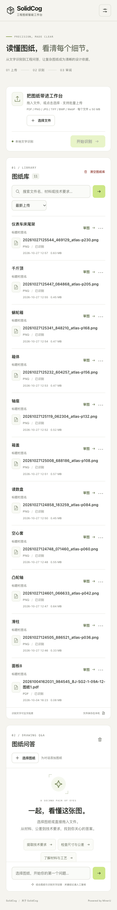
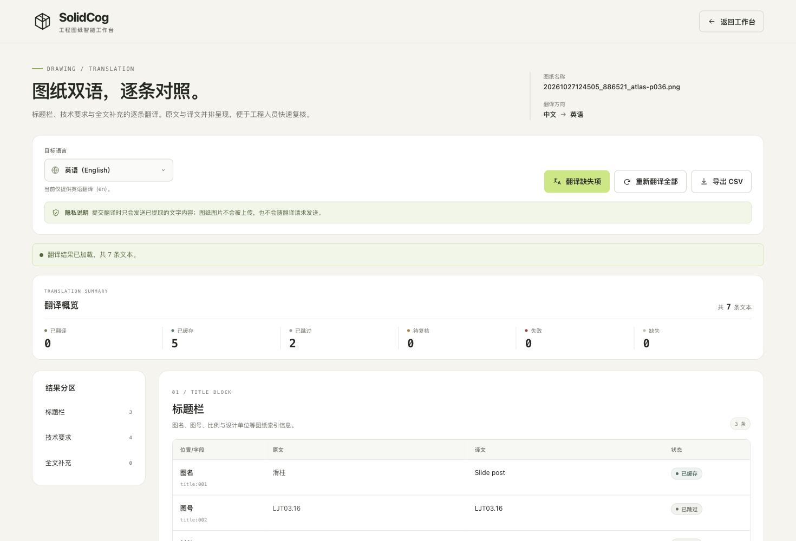
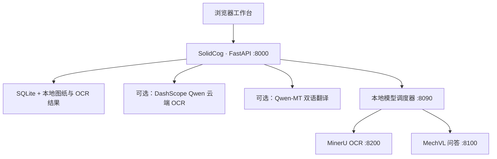

<div align="center">

# SolidCog

**机械工程图纸解析、检索与辅助审图工作台**

本地 MinerU OCR · MechVL 图纸问答 · Qwen 云端识别与双语翻译

[](LICENSE)
[](#安装与启动)
[](#安装与启动)
[](https://github.com/opendatalab/MinerU)

[工作台](#工作台预览) · [功能](#能做什么) · [翻译](#翻译对照) · [安装](#安装与启动) · [使用](#开始处理图纸) · [文档](#文档导航)

</div>



SolidCog 把图纸上传、结构化文字识别、全文检索、双语翻译和图纸问答放进一个浏览器工作台。图纸与识别结果保存在本机，使用 MinerU 与 MechVL 时由本地模型处理；需要云端 OCR 或翻译时，可在“处理设置”中配置一个 Qwen Key。

图纸库会从标题栏提取 **图纸名称（图名）**。即使上传文件名是编码或哈希，也能先按零件名称识别，再通过实际文件名追溯原件；鼠标悬停在图纸名称或文件名上会显示跟随鼠标的图纸预览。

**Powered by MinerU**。分发或向客户及其他第三方提供服务时，请保留文档与界面中的标识，详见[第三方组件与标识](docs/attribution.md)。

## 工作台预览

左侧管理图纸、上传任务与检索结果，右侧围绕选定图纸提问。图纸库现在分成“图纸名称”和“文件名”两列：前者来自标题栏图名，后者保留实际文件；悬停任一列可查看图片缩略图或 PDF 首页。处理设置中可选择 OCR 后端、查看本地模型状态或手动切换模式。

<details>
<summary>查看移动端布局</summary>



</details>

截图使用示例图纸。页面支持桌面、平板与手机布局。

## 最近更新（2026-10-27）

- 图纸库新增 **图纸名称** 列，从标题栏 `图名` 提取，编码文件名不再影响识别；
- 实际文件名独立保留，悬停图纸名称或文件名显示跟随鼠标的预览；
- 图片显示缩略图，PDF 显示第一页，预览图本地缓存；
- 新增 Qwen-MT 双语翻译页：标题栏、技术要求、全文补充逐条对照，支持缺失翻译、重新翻译、状态复核与 CSV 导出；
- 一个 Qwen Key 同时用于 Qwen-VL OCR 和 Qwen-MT，Key 仅显示掩码；
- 术语库、工程数据占位符保护、译文缓存和源文本变化失效已接入翻译流程；
- 10 张真实图集测试结果见[翻译测试报告](docs/translation-test-report-2026-10-27.md)。

## 能做什么

| 工作流 | 已实现能力 |
| --- | --- |
| 上传与归档 | 拖放或批量选择文件，后台 OCR 队列、进度查询、部分失败提示与重试 |
| 图纸名称识别 | 从标题栏提取图名，编码文件名与图纸名称分开显示，支持无标签标题栏推断 |
| 悬浮预览 | 指向图纸名称或文件名，跟随鼠标显示图片缩略图或 PDF 首页；触屏设备保留原文件链接 |
| 本地文字识别 | MinerU 输出统一的标题栏、技术要求、全文与布局信息，保留原始结构化结果 |
| 云端文字识别 | 可选 DashScope Qwen3-VL，整页概览、重叠分块与重点区域补读 |
| Qwen 通道配置 | 处理设置中填写一个 Key，保存后掩码显示并即时生效；同一 Key 可验证 Qwen-VL 与 Qwen-MT |
| 图纸检索 | 按文件名和 OCR 文本搜索材料、图号、技术要求等内容 |
| 查看与导出 | 独立 OCR 结果页、文字导出、双语翻译对照、CSV 导出、图纸删除 |
| 双语翻译 | 标题栏、技术要求和全文补充逐条对照；支持翻译缺失项、重新翻译、状态复核与 CSV；内置机械术语库、工程数据保护与译文缓存 |
| 辅助审图 | MechVL 结合图纸预览、OCR 上下文和问题回答，支持选图与连续提问 |
| 装配图齐套性检查 | 读取本次导入集合中的装配明细表，按来源装配图分组核对文件名齐套性；支持全量/手动总成模式、备注免查、异常复核、筛选和 CSV 导出 |
| 模型调度 | MinerU 与 MechVL 互斥驻留，显示切换阶段、已用时间与预计剩余时间 |

**输入格式：** PDF、PNG、JPEG、TIFF（含多页）、BMP、WebP。单文件上限 **50 MB**，每批默认最多 **20 个文件**；DWG / DXF 需先导出为 PDF 或图片。Qwen 默认处理前 **10 页**，可用 `QWEN_OCR_MAX_PAGES` 调整，超出限制会提示。

> OCR 可能误读细小尺寸、公差与工程符号；MechVL 的回答用于辅助核对，不能替代工程师的审图与签核。

## 安装与启动

| 路径 | 本地运行时 | 准备事项 | 安装文档 |
| --- | --- | --- | --- |
| macOS / Apple Silicon | llama.cpp / Metal | Python 3.12、llama-server、GGUF 模型及视觉投影文件 | [macOS 安装](docs/installation.md#macos--apple-silicon) |
| Windows / WSL2 | PyTorch / CUDA | Python 3.12、WSL2 Ubuntu、NVIDIA GPU；MinerU 需兼容旧 `/file_parse` 接口 | [Windows 安装与说明](docs/installation.md#windows--wsl2) |
| 仅使用云端 OCR | 主应用 + DashScope | Python 3.12、Qwen API Key；不需要本地模型 | [云端 OCR 最小安装](docs/installation.md#仅使用云端-ocr) |

**先选运行方式，再装依赖。** macOS 使用 `platforms/macos/requirements.txt`，Windows 主应用使用根目录 `requirements.txt`；DashScope Key 在启用 Qwen 云端识别或 Qwen-MT 通道时需要。

已安装环境的日常启动：

**macOS / Apple Silicon**

```sh
./start_macos.command
```

**Windows / WSL2**

```powershell
.\start_server.bat
```

启动后打开 **[SolidCog 工作台](http://127.0.0.1:8000/home)**。请保持启动器终端打开，停止时按 `Control + C` / `Ctrl + C`。

### 当前运行边界

- **macOS 本地链路：** 支持本地 OCR 与流式图纸问答；GGUF 权重不随仓库分发，安装脚本也不负责下载或转换。
- **Windows / WSL2 本地链路：** MechVL 使用 Transformers/CUDA 推理，支持网页流式问答；WSL 服务通过 `/analyze/stream` 输出 SSE，模型调度器通过 `/mechvl/analyze/stream` 转发。MinerU 仍要求兼容 `/file_parse`、`--enable-vlm-preload` 和项目使用的旧响应结构，部署时需单独核对版本。
- **云端 OCR：** 无本地模型也能识别、归档和检索；MechVL 问答仍需本地模型服务。
- **部署范围：** 启动器默认绑定 `127.0.0.1`，面向单机使用。当前没有面向公网的账号与权限系统，客户部署需另行配置访问控制，并保留 MinerU 标识。

## 开始处理图纸

1. 打开右上角“处理设置”，选择 **MinerU 本地识别**或 **Qwen 云端识别**；使用 Qwen 时在同一个面板填写 API Key，点击“确认”并验证两个模型。
2. 拖入文件，点击“开始识别”，等待队列处理；部分失败时可查看原因并重试。
3. 在图纸库按图纸名称、文件名、图号、材料或技术要求检索；悬停图纸名称或文件名可快速查看预览。通过操作菜单查看和导出 OCR，打开“翻译对照”可按条生成英文对照表并导出 CSV。
4. 本地问答环境就绪后，点击图纸行的“审图”，或在助手中选择图纸，再输入问题。
5. 连续审阅同一批图纸时，尽量先完成 OCR，再集中问答，减少模型切换等待。

可尝试的问题：“这张图纸是什么零件？”“标题栏标注了什么材料？”“技术要求中有哪些需要人工复核的项目？”

## 装配图齐套性检查

从工作台顶部“齐套性检查”进入 `/kit-check`。页面默认勾选最近导入批次，勾选本次导入集合后，选择“检查全部装配图”或“手动指定总成图”，系统会读取装配明细表并按来源装配图分组显示每个条目的存在/不存在结果。支持只看不存在、查看免查原因、预览来源/匹配文件、修正单条提取字段后重新匹配，以及导出中文 CSV。详细规则、状态、API、缓存和验证记录见[装配图齐套性检查](docs/kit-check.md)。

> 本功能不读取 Excel 结构 BOM，不做数量/材料/尺寸一致性审查；“存在”只指在本次选定导入集合内存在。`.SLDPRT`/`.SLDASM` 模型文件和未导入的 `.SLDDRW`/`.DWG`/`.DXF` 不参与第一版匹配。

## 翻译对照

翻译功能针对已经提取的 OCR 文本工作，不需要重新上传图纸，也不会在翻译阶段把图纸图片发送给 Qwen-MT。打开任意图纸的“翻译对照”，即可看到标题栏、技术要求和全文补充的原文/译文逐条对照。



1. 在“处理设置”中填写 Qwen API Key，并验证 Qwen-VL 与 Qwen-MT；
2. 打开图纸的“翻译对照”，点击“翻译缺失项”或“重新翻译全部”；
3. 检查状态列中的已翻译/已缓存/已跳过/待复核/失败/缺失；
4. 按需导出 CSV，用于审阅、归档或交给翻译人员。

工程数据保护会覆盖尺寸、公差、硬度、材料牌号、标准号和常见单位；源文本、术语库或模型变化时，旧译文会失效。真实测试覆盖 10 张图集图纸，详细指标与已知 OCR/术语问题见[10 张图翻译测试报告](docs/translation-test-report-2026-10-27.md)。

## 工作原理



`app/` 和 `templates/` 提供共享业务与界面，平台层负责模型进程和硬件后端。MinerU 与 Qwen 的不同输出被映射到统一 OCR 结构，供入库、检索、导出和问答上下文复用。

调度器按需加载目标模型，切换时先停止当前模型、释放资源再启动另一个；推理期间拒绝切换，完成后继续驻留。macOS 使用 Metal / GGUF，Windows 使用 WSL2 / CUDA，两端推理参数与接口支持范围并不完全相同。

### 模型与版本

| 组件 | 当前用途与配置 |
| --- | --- |
| MinerU2.5-Pro-2605-1.2B | 本地图纸解析；通用文档模型，机械符号仍需复核 |
| macOS MinerU 运行库 | `mineru-vl-utils[llama-cpp]==2.0.5`、`mineru-llama-cpp==0.1.5` |
| MechVL-4B-RL | 机械图纸问答；macOS 默认使用 Q5 GGUF，WSL 使用 NF4 4-bit |
| Qwen3-VL-Plus | 可选云端 OCR；由 `QWEN_VL_MODEL` 配置 |
| Qwen-MT-Plus | 翻译模型通道；由 `QWEN_MT_MODEL` 配置，默认复用 Qwen-VL 的 Key 与接口 |

模型名称、推理运行库和完整 MinerU 主程序是不同的版本维度。详见 [macOS 运行时说明](platforms/macos/README.md)。

### 验证与性能

仓库包含路由、OCR 适配、文件处理、模型服务与调度器回归测试，包括 Windows/WSL 调度器 SSE 转发契约。测试命令见下文；自动化测试使用模拟模型响应，不等于真实图纸准确率评测。

Windows / WSL2 的真实联调记录（2026-10-27）使用 **RTX 4060 Laptop 8 GB**：MechVL CUDA 模型加载、网页调度器 SSE 链路和单页 MinerU `/file_parse` 均已通过；单页 MinerU 测试从冷启动至返回结果约 84 秒（含模型切换与预载）。实测依赖版本和适用边界见 [Windows 安装与验证说明](docs/installation.md#windows--wsl2)。冷启动与模型切换可能占用明显时间，分块识别也会增加调用与耗时。两端历史数据的图纸、量化与环境不同，不宜直接比较速度。

完整阶段耗时、测试环境、论文基准与重构对照见[工程设计与历史验证记录](docs/engineering-reference.md)。其中 macOS 2026-10-06 的结果使用旧引擎 `0.1.2`，不是当前 `0.1.5` 的复测成绩。

## 数据与隐私

| 数据 | 默认位置 / 去向 |
| --- | --- |
| 图纸元数据与 OCR 文本 | `database.db` |
| 上传原件 | `uploads/` |
| MinerU 原始结构化输出 | `mineru_results/` |
| API Key 与本地配置 | `.env`，不要提交到 Git；可在“处理设置”中填写，保存后仅显示掩码（POSIX 下文件权限 0600） |
| 聊天记录 | 当前浏览器标签页的 `sessionStorage`，可手动清理 |
| Qwen OCR 输入 | 选择 Qwen 时，图纸页面图像发送至 DashScope |
| Qwen-MT 输入 | 打开翻译并点击翻译时，仅发送已提取文字，不上传图纸图片 |

MinerU OCR 和 MechVL 推理走本地服务；首次安装依赖或下载模型仍需要网络。选择云端模式前，请确认图纸允许传输至对应服务。备份或迁移时至少同时保存 `database.db` 与 `uploads/`；需要保留解析原始记录时一并备份 `mineru_results/`。

## 开发

```text
solidcog/
├── main.py                 # FastAPI 入口
├── app/                    # 配置、路由、业务服务与数据访问
├── templates/              # 工作台、OCR 结果页、关于页与样式
├── platforms/macos/        # Apple Silicon 模型服务与启动器
├── model_scheduler/        # 共享调度核心与 WSL 服务入口
├── mechvl_server/          # WSL / CUDA MechVL 服务
├── tests/                  # Python 回归与浏览器验证脚本
├── docs/                   # 安装、验证、署名与截图
├── start_macos.command     # macOS 日常启动
└── start_server.bat         # Windows 日常启动
```

运行 Python 回归测试：

```sh
# macOS
.venv/bin/python -m unittest discover -s tests -v
```

```powershell
# Windows
.\.venv\Scripts\python.exe -X utf8 -m unittest discover -s tests -v
```

服务启动后，可在 [主应用 API 文档](http://127.0.0.1:8000/docs) 查看完整接口，在[调度器状态](http://127.0.0.1:8090/status) 查看模型模式、忙碌状态与切换进度，在[关于页](http://127.0.0.1:8000/about) 查看组件署名。

## 文档导航

| 文档 | 内容 |
| --- | --- |
| [安装与排障](docs/installation.md) | macOS、Windows / WSL2、云端 OCR 与常见问题 |
| [macOS 运行时](platforms/macos/README.md) | 平台层、依赖版本、健康检查与日志 |
| [装配图齐套性检查](docs/kit-check.md) | 规则、状态、API、缓存、浏览器与真实 Qwen 验证记录 |
| [工程设计与历史验证](docs/engineering-reference.md) | OCR 契约、调度设计、历史性能、论文与 BibTeX |
| [OCR 验证记录](docs/ocr-validation-2026-10-04.md) | 识别完整性、分区与已知限制 |
| [翻译 MVP 合同](docs/translation-mvp-contract.md) | 分段、接口、状态与 CSV 契约 |
| [翻译图集验证](docs/translation-atlas-validation-2026-10-27.md) | 图集样本、OCR 边界与翻译纵切验证 |
| [10 张图翻译测试报告](docs/translation-test-report-2026-10-27.md) | 真实 Qwen-VL/Qwen-MT 测试、指标与问题清单 |
| [工作台验证记录](docs/workbench-design-validation-2026-10-04.md) | 响应式布局、浏览器交互与验证范围 |
| [MinerU 版本核对](docs/mineru-upgrade-2026-10-04.md) | 2026-10-04 的版本升级与兼容性记录 |
| [第三方组件与标识](docs/attribution.md) | MinerU 署名要求与组件归属 |

## 许可与致谢

SolidCog 自有代码采用 [Apache License 2.0](LICENSE)，第三方组件与模型分别遵循自身许可，详见 [NOTICE](NOTICE)。

- **[MinerU](https://github.com/opendatalab/MinerU)**：文档解析能力；项目采用带附加署名条款的 MinerU Open Source License，需保留 **Powered by MinerU**。
- **[MinerU2.5-Pro 权重](https://huggingface.co/opendatalab/MinerU2.5-Pro-2605-1.2B)**：Apache-2.0；模型权重不包含在本仓库中。
- **[mineru-llama-cpp](https://github.com/opendatalab/mineru-llama-cpp)** 与 **[llama.cpp](https://github.com/ggml-org/llama.cpp)**：MIT；macOS 引擎锁定为包含许可证文件的 `0.1.5`。
- **[MechVL-4B-RL](https://huggingface.co/XiaofengAlg/MechVL-4B-RL)**：Apache-2.0，由原作者发布。使用时请引用 *MechVQA: Benchmarking and Enhancing Multimodal LLMs on Comprehensive Mechanical Drawing Understanding*（2026），[论文与引用格式](docs/engineering-reference.md#论文引用)。
- **DashScope / Qwen**：选择云端 OCR 时适用对应服务条款。
